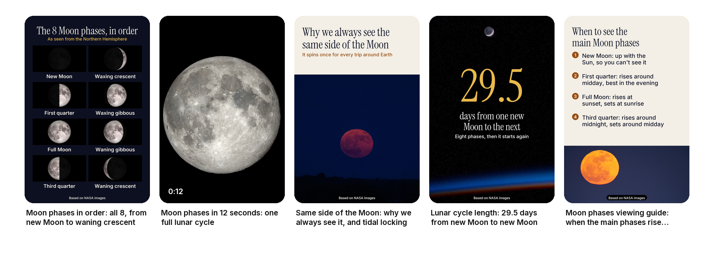

# Pinterest Skill for Claude Code, Codex, Cursor and OpenClaw

**Pinterest Skill** is a free, open-source Pinterest skill for Claude Code and other AI agents that makes, checks, previews and schedules Pinterest pins. You give your agent a link (a blog post, a product, a recipe, a guide) and your own photos or videos. It reads the page, designs several genuinely different pins for it, writes the titles, descriptions and alt text, checks every pin against Pinterest's limits and the spam patterns that get accounts flagged, shows you the batch in the home feed, spreads it over the coming weeks, and schedules it through [WoopSocial](https://woopsocial.com/social-media-mcp/pinterest-mcp?utm_source=pinterest-skill&utm_medium=readme) after you say yes:

- 3 to 5 fresh designs per page, each with its own picture: photo, split, grid, big-number fact, list or photo-only layouts at 1000x1500;
- video pins from your own clip or photos, fitted to 2:3 or 9:16 and opening on the strongest frame;
- the search phrase first in every title (only about 40 characters show in the feed), descriptions that match the page, alt text, no hashtags;
- the link checked: the page's own final URL, no shorteners, no redirects, the pin matching what the page delivers;
- repeats blocked: look-alike pins or a shared source photo for one page, a picture already pinned to the same page (tracking parameters don't make it new), one page sent to several boards on one day;
- a steady pace: about one pin a day, new pins for one page a week apart, seasonal pins 90 to 45 days before the moment;
- results read from day 30, ranked by outbound clicks, then saves, against your own pins.

Everything up to scheduling runs locally with Python and Pillow (ffmpeg for video pins). No paid API, no Pinterest developer app. MIT licensed.

```bash
npx skills add social-media-skills/pinterest-skill -g -a claude-code -y
```



*The example in [`examples/moon-phases/`](skills/pinterest-skill/examples/moon-phases/): five pins for NASA's Moon phases page, made only from NASA images, NASA's Moon phase animation and illustrations based on them. Every pin, check, preview, schedule and request in it was made by the skill's scripts. See [CREDITS](skills/pinterest-skill/examples/moon-phases/CREDITS.md).*

## Contents

- [What the Pinterest skill does](#what-the-pinterest-skill-does)
- [Requirements](#requirements)
- [Install](#install)
- [Example: make Pinterest pins with Claude Code](#example-make-pinterest-pins-with-claude-code)
- [What it checks](#what-it-checks)
- [Scheduling pins without a Pinterest developer app](#scheduling-pins-without-a-pinterest-developer-app)
- [What it won't do](#what-it-wont-do)
- [FAQ](#faq)
- [What's inside](#whats-inside)

## What the Pinterest skill does

Tell your agent "make Pinterest pins for this post", "schedule pins for my Etsy listing", "turn this video into a Pinterest video pin" or "which of my pins are working" and it does the whole job:

1. **Knows the account.** It asks once about the site, the audience, your boards and brand (and checks you have a business account with the website claimed), and reads the boards from WoopSocial.
2. **Reads the page** with `page.py`: the final URL, title, headings and images, so every pin promises what the page delivers.
3. **Plans different pins on purpose:** the result, the steps at a glance, one striking number, a list, the photo alone, a video. Same page, new angle, new picture.
4. **Makes the pins** from your photos with `render_pins.py`, and video pins with `video.py`.
5. **Writes the text:** keyword-first titles, plain descriptions, alt text.
6. **Checks** everything with `pin_check.py` and fixes files that can be fixed safely.
7. **Picks the dates** with `schedule.py`: a steady trickle, seasonal pins well ahead.
8. **Uploads and validates** every pin with WoopSocial.
9. **Shows a preview** (the batch in the home feed at real size, then each pin's close-up), waits for one clear yes, schedules, and logs every pin so the same picture never goes to the same page twice.
10. **Learns** from day 30: outbound clicks per 1,000 impressions, then saves, compared across the designs for each page.

## Requirements

- Python 3.9 or newer with Pillow (`pip install pillow`); on Windows also `pip install tzdata`.
- ffmpeg for video pins. Image pins work without it.
- An agent that can run commands on your computer (Claude Code, Codex, Cursor, OpenClaw or similar).

`python3 scripts/check_setup.py` tells you what's missing and the install command for your system. A CI workflow runs the full pipeline on macOS, Windows and Ubuntu.

## Install

**Claude Code**

```bash
npx skills add social-media-skills/pinterest-skill -g -a claude-code -y
```

**Codex, Cursor and other agents:** run `npx skills add social-media-skills/pinterest-skill` and pick your agent, or copy `skills/pinterest-skill/` into your agent's skills directory.

**OpenClaw (ClawHub):** `openclaw skills install @social-media-skills/pinterest-skill`

**GitHub CLI:** `gh skill install social-media-skills/pinterest-skill pinterest-skill`

**Gemini CLI:** `gemini extensions install https://github.com/social-media-skills/pinterest-skill`

## Example: make Pinterest pins with Claude Code

```
You:   Make Pinterest pins for NASA's Moon phases page, using NASA
       images. Boards: "Moon and night sky" and "Space science lessons".

Agent: I read the page (final URL, 27 headings, the 8 phases, 29.5 days
       per cycle, when each phase rises and sets). Five pins, each a
       different angle with its own picture: all 8 phases in a grid, a
       12-second video of one cycle cut from NASA's Moon phase
       animation, a full Moon over Kennedy Space Center for "why we
       always see the same side", a big "29.5" for the cycle length,
       and when to see the main phases.
       Checks pass and WoopSocial validated all five. They go out one a
       week from Monday at 20:30 New York, so Pinterest sees fresh pins
       for the page, not a burst. Preview: preview/index.html.
       Schedule them?

You:   Yes.

Agent: Scheduled: 5 pins, Mon 16 Nov to Mon 14 Dec. Alt text for each
       is in schedule.md to paste in Pinterest once they're live. I'll
       read the numbers from day 30, not before.
```

The pins, video, check report, preview, schedule and WoopSocial requests from this run are in [`examples/moon-phases/`](skills/pinterest-skill/examples/moon-phases/).

## What it checks

| Check | Rule | Why |
|---|---|---|
| Image | JPEG or PNG, up to 20 MB, 2:3 (1000x1500) | Pinterest's specs; taller than 1:2.1 is cut in the feed |
| Video | MP4, MOV or M4V; H.264 or H.265; 4 s to 15 min; up to 2 GB; 1:1, 2:3, 4:5 or 9:16 | Pinterest's specs |
| Title | Up to 100 characters, the keyword in the first 40 | Only about 40 show in the feed |
| Description | Up to 800 characters, the point in the first 500, keywords used | Some screens still cut at 500 |
| Alt text | Up to 500 characters | Pinterest's limit |
| Hashtags | Flagged | They do nothing on Pinterest any more |
| Link | A full https:// address, the final URL, no shorteners, no redirects, words shared with the page | Pinterest can block shorteners and redirects as spam and wants the pin to match its page |
| Board | One of the account's boards | A pin needs a board |
| Look-alikes | Two pins for one page with the same picture or source photo | Each pin needs its own design |
| Repeats | A picture already pinned to the same page (from the log), whatever tracking parameters the link has | Pinterest treats re-uploading the same content as spam |
| Boards per page | One page to several boards on one day | A spam pattern practitioners report |
| Pace | Pins per account per day, posted ones included; new pins for one page a week apart | Bursts get accounts flagged |
| Image text | The headline's height at feed size; characters the font can't draw | If it can't be read there, it can't be read on a phone |

Each rule, with its source, is in [`references/pinterest-specs.md`](skills/pinterest-skill/references/pinterest-specs.md).

## Scheduling pins without a Pinterest developer app

Scheduling goes through [WoopSocial](https://woopsocial.com/?utm_source=pinterest-skill&utm_medium=readme), a social media API and MCP server for AI agents. Disclosure: this skill is maintained by Frank Heijdenrijk and the team behind WoopSocial. The free plan covers 2 social accounts. Setup steps for every agent are at [woopsocial.com/agents](https://woopsocial.com/agents?utm_source=pinterest-skill&utm_medium=readme).

A new Pinterest developer app starts on trial access, where pins are visible only to you; public pins need an app review. Pins sent through WoopSocial use its approved app, so they're public from the start.

The agent uploads each pin, writes one request per pin with the board, title, description and link, validates them with WoopSocial, and only then shows you the preview and the schedule. It schedules only after a clear yes. WoopSocial doesn't send alt text, so the skill lists each pin's alt text in `schedule.md` to paste in Pinterest after publishing. WoopSocial doesn't design pins or write text; the skill does that on your computer and you approve it.

## What it won't do

- Invent numbers, results or search volumes. Every fact on a pin needs a source.
- Schedule anything without your yes on the preview.
- Re-upload a picture already pinned to the same page, or pin one page to many boards at once.
- Use other people's pins or images, scrape Pinterest, or automate follows and repins.
- Add hashtags or keyword lists.
- Judge a pin before day 30, or tell you to delete and re-pin slow pins.
- Generate AI images. If you use them, it reminds you to say so.

## FAQ

**What is a Pinterest skill?** An agent skill (a folder with a `SKILL.md`) that teaches an AI agent such as Claude Code how to do a job on Pinterest. This one includes the scripts that make and check the pins, so the agent produces real pins, not just advice.

**Can Claude post to Pinterest?** Yes. With this skill and WoopSocial connected, Claude Code, Claude Desktop, Codex, Cursor and OpenClaw can schedule image and video pins to your boards after you approve each batch.

**Is this a Pinterest MCP?** The skill schedules through [WoopSocial's MCP server](https://woopsocial.com/social-media-mcp/pinterest-mcp?utm_source=pinterest-skill&utm_medium=readme). The skill adds what an MCP alone doesn't: designing the pins, writing the text, checking everything against Pinterest's rules, the preview, the pacing and the learning loop.

**Do I need a Pinterest API key or developer account?** No. You connect your Pinterest account to WoopSocial and the skill schedules through it.

**How many pins should I post a day?** The skill defaults to one a day per account and stops above five. Pinterest has no official cap; people who run Pinterest accounts for a living lean towards fewer, better pins.

**How many pins per blog post?** Three to five different designs to start, a week apart, and more over the following months. Each needs its own picture; Pinterest treats re-uploading the same content as spam.

**Do hashtags work on Pinterest?** No. They haven't been clickable for years. Put the words in the title and description instead.

**When can I tell if a pin works?** From day 30. New pins often get few impressions in their first days, and Pinterest says there's no set window: older pins can take off later.

**Does it work without WoopSocial?** Yes. Everything up to the schedule is local; without it you upload the pins yourself.

## What's inside

```
skills/pinterest-skill/
  SKILL.md                 the workflow the agent follows
  scripts/
    check_setup.py         what's installed, and how to add what isn't
    page.py                reads the linked page: final URL, title, headings, images
    render_pins.py         pins in six layouts at 1000x1500 (JPEG), contact sheet, manifest
    video.py               video pins: fit a clip, photos to video, frame sheet
    pin_check.py           checks every pin, its text, link, board, repeats and pace; fixes files
    schedule.py            spacing, seasonal lead, WoopSocial requests, schedule.md
    preview.py             the preview: home feed at real size and each close-up
    upload_parts.py        uploads files to WoopSocial
    log.py                 pin log (stops repeats) and results from day 30
    pinlib.py              shared limits and helpers
  references/              Pinterest specs, writing, plan.json, scheduling
  fonts/                   Inter and Instrument Serif (SIL Open Font License)
  examples/moon-phases/    a full batch with every output
  evals/evals.json         14 test prompts
```

The NASA images in the example are credited in [CREDITS](skills/pinterest-skill/examples/moon-phases/CREDITS.md); their use doesn't imply endorsement by NASA.

More free skills for social media from the same team: [social-media-skills.com](https://social-media-skills.com/?utm_source=pinterest-skill&utm_medium=readme).
